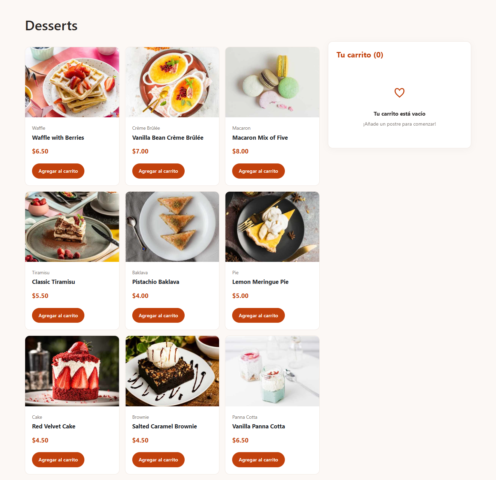

# Desserts · Carrito de compras

Catálogo de postres con carrito persistente y registro de pedidos en MySQL. Un proyecto que evolucionó desde un ejercicio de Frontend Mentor en JavaScript hasta una aplicación con React, TypeScript y una API propia en PHP.

**[Ver demo](https://dessert-cart-api.infinityfree.io/)** · **[Código en GitHub](https://github.com/Alexxeyrp/app_carrito_de_compras_ts)**



[Vista móvil](docs/screenshots/mobile.png) · [Confirmación de un pedido local de prueba](docs/screenshots/order-confirmed.png)

## Funcionalidades

- Catálogo de nueve postres obtenido desde PHP y MySQL, con estados de carga y error.
- Añadir y eliminar productos, cambiar cantidades de 1 a 10 y vaciar el carrito.
- Contador de unidades y total actualizado en tiempo real.
- Persistencia en `localStorage`, con validación de los datos guardados.
- Confirmación de pedidos y resumen en un modal.
- Registro del pedido y sus líneas en una transacción MySQL.
- Precios calculados en el servidor: el navegador solo envía identificadores y cantidades.
- Interfaz adaptable a móvil y escritorio, con etiquetas accesibles en los controles del carrito.

Es una demo educativa: confirmar un pedido crea registros de demostración. No hay pagos, cuentas de usuario, envíos ni gestión de inventario.

## Tecnologías

| Interfaz | API y datos | Herramientas |
| --- | --- | --- |
| React 19, TypeScript, CSS, Bootstrap 5 | PHP, PDO, MySQL / MariaDB | Vite 8, ESLint, npm, GitHub Actions |

Bootstrap CSS se carga desde jsDelivr; las imágenes se incluyen en el repositorio. El catálogo procede de MySQL. `src/data/db.json` conserva los datos del ejercicio original como referencia; no sustituye a la API.

## Requisitos

- Node.js 22.13 o posterior en la rama 22, o una versión compatible con `engines` en `package.json`.
- npm y Git.
- PHP 8.2 o posterior con `pdo_mysql`.
- MySQL 8 o MariaDB 10.4 o posterior. XAMPP permite ejecutar PHP, Apache y MariaDB en Windows.

## Instalación local

### 1. Frontend

```bash
git clone https://github.com/Alexxeyrp/app_carrito_de_compras_ts.git
cd app_carrito_de_compras_ts
npm ci
```

En PowerShell, copia la configuración de ejemplo:

```powershell
Copy-Item .env.example .env.local
```

### 2. Backend y base de datos

1. Copia la carpeta `carrito-api` del repositorio a `C:\xampp\htdocs\carrito-api`. Conserva los archivos `.htaccess`.
2. Arranca Apache y MySQL en XAMPP.
3. En phpMyAdmin crea una base vacía, por ejemplo `carrito_db`, con juego de caracteres `utf8mb4`.
4. Selecciona esa base e importa primero `carrito-api/database/schema.sql` y después `carrito-api/database/seed.sql`.
5. En la copia de XAMPP, copia `config/database.local.example.php` a `config/database.local.php` y rellena los datos de conexión. Comprueba el puerto de MySQL. Utiliza las credenciales locales que tengas configuradas o crea un usuario dedicado.
6. Abre `http://localhost/carrito-api/api/products.php`: debe devolver un array JSON de nueve productos.

Los SQL crean una instalación nueva derivada de las consultas de la API; no son un volcado de producción ni una migración. No los importes sobre una base con datos existentes. No contienen pedidos ni credenciales.

El archivo privado de conexión queda fuera de Git. PHP también admite variables de entorno del servidor. Los archivos `.env` del frontend no configuran MySQL. Más detalles en la [documentación del backend](carrito-api/README.md).

### 3. Ejecutar la aplicación

```bash
npm run dev
```

Abre `http://localhost:5173`. Vite dirige `/api/...` a `http://localhost/carrito-api/api/...`, de modo que las mismas rutas funcionan en desarrollo y producción. El puerto es fijo: si está ocupado, cierra el servidor anterior o configura el puerto y el origen permitido en PHP.

Si editas el backend dentro del repositorio, copia sus cambios a XAMPP para probarlos; son carpetas independientes. Conserva el archivo privado de conexión de XAMPP al actualizar el código.

## Configuración por entorno

| Opción | Dónde se configura | Uso |
| --- | --- | --- |
| `VITE_API_BASE_URL` | `.env.local` o `.env.production.local` | Ruta pública de la API; por defecto `/api`. Se incorpora al compilar. |
| `API_PROXY_TARGET` | `.env.local` | Destino del proxy de desarrollo y preview; por defecto `http://localhost/carrito-api`. |
| `DB_HOST`, `DB_PORT`, `DB_NAME`, `DB_USER`, `DB_PASSWORD` | Entorno PHP o `config/database.local.php` privado | Conexión MySQL. |
| `CORS_ALLOWED_ORIGINS` | Entorno PHP o configuración privada | Orígenes exactos separados por comas, sin rutas ni barra final. |
| `DB_CONFIG_FILE` | Entorno PHP | Ruta absoluta opcional a un archivo PHP privado fuera de la carpeta pública. |

Las variables del entorno PHP tienen prioridad sobre el archivo privado. PHP no carga `.env` automáticamente. Las opciones `VITE_*` son visibles en el navegador: no deben contener contraseñas ni claves. Referencia: [variables de entorno de Vite](https://vite.dev/guide/env-and-mode.html).

El proxy de Vite se utiliza al ejecutar los servidores de desarrollo y preview. El hosting de producción debe servir la API PHP; GitHub Pages no ejecuta PHP.

## Build y comprobaciones

```bash
npm run lint
npm run build
npm run preview
```

El build comprueba TypeScript y genera `dist/`. Preview abre `http://localhost:4173` y utiliza el mismo proxy local; necesita el backend activo. Para comprobar PHP en PowerShell:

```powershell
Get-ChildItem carrito-api -Recurse -Filter *.php | ForEach-Object {
    php -l $_.FullName
    if ($LASTEXITCODE -ne 0) { throw "Error de sintaxis PHP" }
}
```

GitHub Actions ejecuta instalación reproducible, lint, build y comprobación de sintaxis PHP en cada push y pull request. El workflow no despliega ni escribe en la base de datos.

Auditoría del lock del 6 de noviembre de 2026: `npm audit --omit=dev` no informa vulnerabilidades. La auditoría completa conserva diez avisos moderados de desarrollo relacionados con [minimatch](https://github.com/advisories/GHSA-g3hv-75wg-m249); se han aplicado las correcciones compatibles y queda pendiente una actualización de sus dependientes. No se ha forzado un cambio mayor de esa dependencia transitiva.

Prueba manual con una base local: añadir dos productos, cambiar cantidades, recargar para comprobar persistencia, eliminar un producto y confirmar. Comprueba un registro en `orders` y sus líneas en `order_items`. Un JSON inválido, cantidades fuera de rango y un identificador inexistente deben rechazarse sin guardar pedidos parciales.

## Despliegue en un hosting PHP

La configuración sirve la aplicación desde la raíz del dominio, como la demo. Para publicar bajo una subcarpeta hay que adaptar `base` de Vite, la ruta de la API y las rutas de imágenes de MySQL.

1. Copia `.env.production.example` a `.env.production.local`. Mantén `VITE_API_BASE_URL=/api` para frontend y API bajo el mismo dominio.
2. Ejecuta `npm ci`, `npm run lint` y `npm run build`.
3. Sube **el contenido de `dist/`** a la carpeta pública del hosting.
4. Sube `api/` y `config/` desde `carrito-api`, además de `carrito-api/.htaccess`, al mismo nivel que `index.html`. Conserva `config/.htaccess`. Revisa las reglas propias del hosting antes de sustituir su `.htaccess`.
5. Configura MySQL en el servidor. Usa `DB_CONFIG_FILE` fuera de la carpeta pública si el hosting permite definirlo; en caso contrario crea allí `config/database.local.php` a partir del ejemplo. No publiques su contenido en GitHub.
6. Establece `CORS_ALLOWED_ORIGINS` al origen de producción, por ejemplo `https://dessert-cart-api.infinityfree.io`. El navegador también envía `Origin` en el POST al mismo dominio y ese origen debe estar permitido. Sustituye los orígenes locales del ejemplo.
7. Desactiva `display_errors` y activa `log_errors` en PHP. Comprueba que `/config/` responde con acceso denegado y que la API devuelve JSON sin detalles internos.

```text
htdocs/
├── index.html
├── .htaccess
├── assets/
├── images/
├── api/
│   ├── bootstrap.php
│   ├── products.php
│   └── orders.php
└── config/
    ├── .htaccess
    ├── environment.php
    ├── database.php
    └── database.local.php  # privado, creado en el servidor
```

No subas `.git`, `node_modules`, el código fuente de React, `.env`, SQL, documentación ni copias de seguridad a la carpeta pública. La base se prepara por separado desde phpMyAdmin, con una copia de seguridad previa si ya contiene datos. El servidor integrado de PHP no aplica `.htaccess`; utiliza Apache con estas reglas o una configuración equivalente.

## API

| Método y ruta | Respuesta correcta |
| --- | --- |
| `GET /api/products.php` | `200` y array de productos con identificador, nombre, categoría, precio e imágenes. |
| `POST /api/orders.php` | `201` con `success`, `order_id`, `total` y `message`. |
| `OPTIONS` en ambas rutas | `204` para un origen permitido. |

Cuerpo del POST, con `Content-Type: application/json`:

```json
{"items":[{"id":1,"quantity":2},{"id":3,"quantity":1}]}
```

La API rechaza productos duplicados, cantidades fuera de 1–10, más de 100 líneas y cuerpos superiores a 64 KiB. Recalcula precios desde MySQL y revierte la transacción si falla una inserción. Los errores devuelven `{"error":"…"}`. CORS limita el acceso desde navegadores; esta demo pública no incluye autenticación ni control de abuso.

## Estructura

```text
├── .github/workflows/ci.yml
├── carrito-api/           # API, configuración de ejemplo y scripts SQL
├── public/images/        # Recursos del catálogo
├── src/
│   ├── components/       # Productos y confirmación del pedido
│   ├── data/db.json      # Referencia del catálogo original
│   ├── lib/products.ts   # Validación de productos recibidos
│   ├── types/            # Tipos de productos y carrito
│   ├── App.tsx           # Estado, persistencia y peticiones
│   └── index.css
├── .env.example
├── .env.production.example
└── vite.config.ts
```

## Aprendizajes y próximos pasos

Componentes reutilizables, estado inmutable, efectos con cancelación, tipado de respuestas, configuración por entorno, consultas preparadas y transacciones. La siguiente evolución puede incorporar pruebas automatizadas del flujo completo, gestión del foco del modal y protección frente a pedidos repetidos y abuso.

Diseño y recursos del reto [Product list with cart de Frontend Mentor](https://www.frontendmentor.io/challenges/product-list-with-cart-5MmqLVAp_d). Implementación y evolución: [Alexxeyrp](https://github.com/Alexxeyrp).
